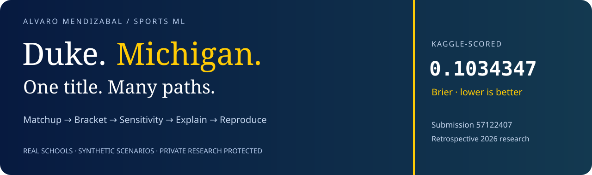
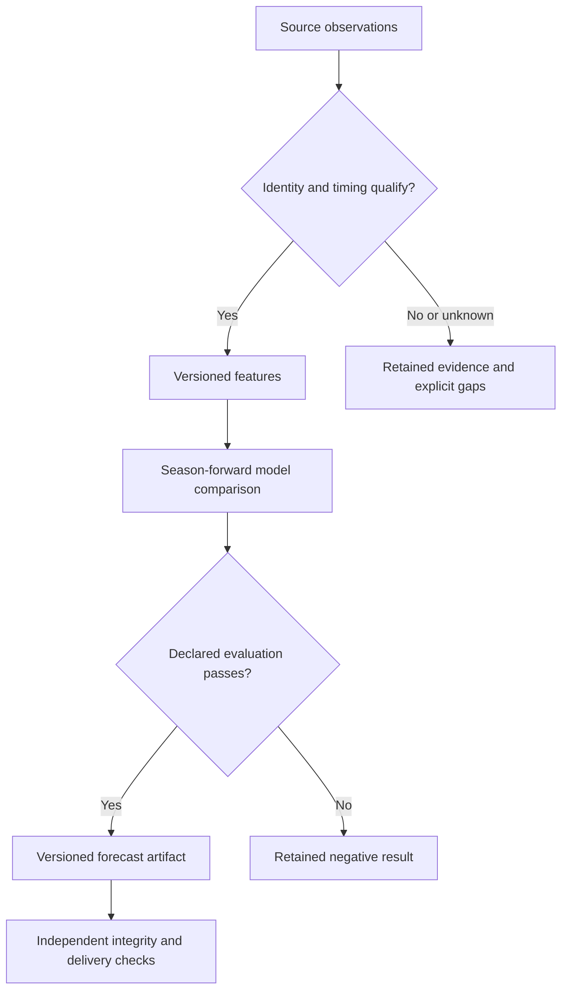

# Tournament Lab

**Alvaro Mendizabal · Machine learning engineering · Applied data science**

[](https://github.com/alvaromendizabal/march-machine-learning-mania-2026/actions/workflows/ci.yml)
[](https://github.com/alvaromendizabal/march-machine-learning-mania-2026/actions/workflows/public-demo.yml)
[](https://github.com/alvaromendizabal/march-machine-learning-mania-2026/actions/workflows/current-research.yml)

[](START_HERE.md)

## A probability is only useful when its evidence holds up.

I built an NCAA forecasting research system across **data qualification, men's and women's probability models, chronological evaluation and recoverable AWS execution**. This repository makes the work inspectable: a basketball scenario lab, six executed research notebooks, a public evaluation pipeline, and an independently authored recovery example that stops, resumes and rejects corrupted state.

**[Explore Duke × Michigan ↗](https://raw.githack.com/alvaromendizabal/march-machine-learning-mania-2026/main/public-demo/index.html)** · **[Review the engineering](START_HERE.md)** · **[Inspect current evidence](docs/engineering_review.md)**

| Result | Evidence and interpretation |
|---|---|
| **0.1034347 Kaggle Brier** | [Recorded public/private score](docs/champion_result.md), submission 57122407. Retrospective 2026 research; prospective performance is unproven. |
| **132,133 possible-matchup probabilities** | [Normalized result record](reports/champion_result/kaggle_record.json), with separate men's and women's populations. These are forecast rows, not scored games. |
| **133 of 221 missing detailed records recovered** | [Current acquisition snapshot](portfolio/acquisition_progress.json). Numerical research candidates; historical admission is a separate, still-open gate. |
| **Completed work survives and verifies** | [Runnable reliability example](tools/reliability_demo.py): exact resume, zero qualification recomputation on a warm run and corrupt-checkpoint rejection on synthetic inputs. |

## Review it in one command

From a checkout, with **Python 3.12 and Node**:

```bash
python tools/review_project.py
```

Open **outputs/review/index.html**. The command executes the public forecast and scoring example, historical receipt checks, recovery tests, current aggregate checks, bracket engine and UI handlers, and deterministic offline demo packaging. It writes a readable report plus JSON evidence. It needs **no credentials, cloud account, private data or package installation**. [Setup and review contract](START_HERE.md#ten-minute-technical-review)

The public examples reproduce their own calculations. Competitive forecasting recipes, learned weights, private source banks and row-level forecasts remain private. [Reproduction levels](docs/reproduction_matrix.md) · [Publication boundary](portfolio/DISCLOSURE.md)

## Three ways to inspect the work

| Review path | What it demonstrates | Start here |
|---|---|---|
| **Applied modeling** | Separate men's/women's branches, calibration, season-forward evaluation, matched comparisons and negative results | [Model card](docs/model_card.md) · [Model-comparison notebook](notebooks/03_model_comparison_and_diagnostics.ipynb) |
| **Data and ML systems** | Source identities, timing boundaries, explicit missingness, content verification, independent stages and durable recovery | [Engineering case study](docs/employer_walkthrough.md) · [Executed engineering review](portfolio/engineering_review.ipynb) |
| **Product communication** | Duke–Michigan scenarios, exact bracket propagation, sensitivity, path attribution, scenario replay and printable briefs | [Interactive lab](https://raw.githack.com/alvaromendizabal/march-machine-learning-mania-2026/main/public-demo/index.html) · [Analyst walkthrough](docs/scouting_walkthrough.md) |

## From source to decision



[Architecture](docs/architecture.md) · [Evaluation protocol](docs/research_protocol.md) · [Source ownership](docs/supplemental_source_ownership.md)

## Current research: acquisition is not qualification

The latest inspected execution recovered **two** missing box scores and preserved prior validated candidates. It attempted all **72** venue acquisition units and captured **62** new source bodies, but **27** source-processing errors prevented a complete result. Only **6 of 583** required women's venue rows qualified. The run remains **PARTIAL**, with **zero new model fits or submissions**.

Downloaded pages, valid numerical records, historically eligible inputs and completed model experiments are different milestones. The snapshot makes their denominators explicit. [Current research](docs/current_research.md) · [Evidence map](docs/evidence_map.md)

## What the scored result establishes

**0.1034347** is the recorded Kaggle public/private Brier for the featured retrospective submission. Lower Brier indicates lower probability error on scored games. Outcomes were already available; the score does not establish an official competition victory, untouched validation, accuracy percentage or profitability. The demo's ratings, bracket positions, prices and outcomes are authored synthetic scenarios, separate from the scored forecast.

Earlier scored receipts and method attribution remain in the [historical comparison](docs/benchmark_comparison.md). The [2027 evaluation contract](docs/2027_readiness.md) defines what future evidence must establish.

**Stack:** Python, pandas, scikit-learn, XGBoost, LightGBM, Plotly, AWS SageMaker, GitHub Actions and dependency-free browser calculations.

**Author:** [Alvaro Mendizabal](https://github.com/alvaromendizabal) · [MIT license](LICENSE) · [Attribution and disclosure](portfolio/DISCLOSURE.md)
