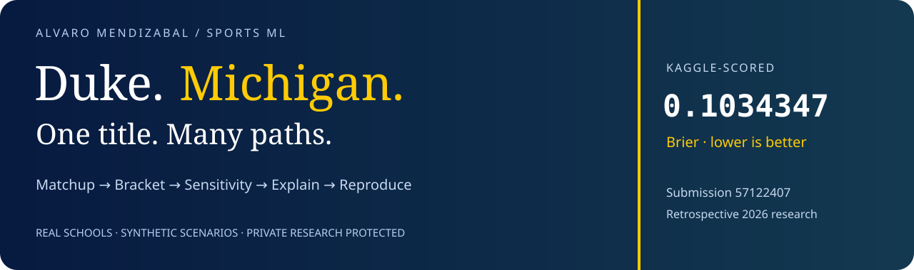
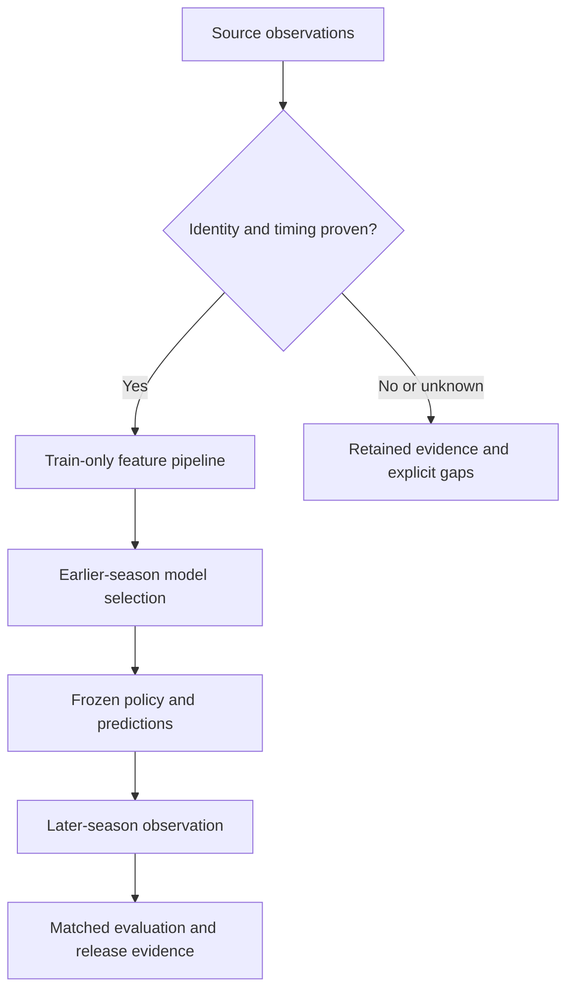

# Tournament Lab

**Alvaro Mendizabal · ML engineering · Applied data science · Reliable AI systems**

[](https://github.com/alvaromendizabal/march-machine-learning-mania-2026/actions/workflows/ci.yml)
[](https://github.com/alvaromendizabal/march-machine-learning-mania-2026/actions/workflows/public-demo.yml)
[](https://github.com/alvaromendizabal/march-machine-learning-mania-2026/actions/workflows/current-research.yml)

[](START_HERE.md)

## A forecast is only as useful as the evidence behind it.

I built a basketball probability-research system connecting **source qualification, chronological ML, probability evaluation and recoverable cloud execution**. This independent March Machine Learning Mania project exposes the engineering decisions—not just a leaderboard number.

**[Explore the interactive lab ↗](https://raw.githack.com/alvaromendizabal/march-machine-learning-mania-2026/main/public-demo/index.html)** · **[Five-minute engineering review](START_HERE.md)** · **[Run a real training example](docs/temporal_model_demo.md)**

| Engineering question | Inspectable evidence | Important boundary |
|---|---|---|
| Can you build and evaluate an ML pipeline? | [Actual temporal training](tools/temporal_model_demo.py), train-only transforms, probability diagnostics and deterministic artifacts | Fictional data, not NCAA performance |
| Can you prevent leakage and resist misleading gains? | [925-game matched replay](docs/source_readiness.md#the-matched-study-is-not-a-new-holdout), development screens and unchanged control | Later labels were already exposed; no score-selected promotion |
| Can you own data and production reliability? | [Source audit](docs/source_readiness.md), [interrupt/resume/corruption tests](tools/test_reliability_demo.py), immutable evidence and failure returns | 67 bodies verified; identity and eligibility remain unresolved |
| Can you communicate a model as a product? | Bracket propagation, sensitivity, path attribution, scenario replay and printable briefs | Browser ratings, prices and outcomes are authored synthetic scenarios |

## Run the public review

From a checkout with **Python 3.12 and Node**, no credentials or package installation:

```bash
python tools/review_project.py
```

Open **outputs/review/index.html**. Thirteen checks cover actual synthetic ML training and evaluation, source contracts, recovery, evidence arithmetic, browser calculations and offline packaging. **review.json** records results and source hashes. [Setup and reproduction levels](START_HERE.md#ten-minute-technical-review)

For training alone:

```bash
python tools/temporal_model_demo.py --out-dir outputs/temporal-demo
```

This fits regularized logistic models on expanding prior-season windows. Scaling is learned from training rows only; future outcomes cannot alter earlier forecasts. The fixed protocol and tests are public, independent of the private competitive model.

## Results, with their denominators

| Evidence | What it establishes | What it does not establish |
|---|---|---|
| **0.1034347 Kaggle Brier** | [Recorded retrospective score](docs/champion_result.md), submission 57122407 | Prospective performance, an official competition win or profitability |
| **132,133 possible-matchup probabilities** | [Normalized submission record](reports/champion_result/kaggle_record.json) | 132,133 scored games |
| **925 matched games / 218 common feature games** | [V018 study](portfolio/source_readiness.json): control Brier 0.1694094; candidate A 0.1675881 | A selected replacement or new holdout; every paired interval includes zero |
| **67/67 bodies verified / zero admissions** | [V019 source audit](docs/source_readiness.md), 54 distinct content identities | Complete provider acquisition, closed debt or proven pregame clocks |

The 925-game study, historical 126-game retrospective and Kaggle receipt are **different populations**, not equivalent tests. Control remains unchanged.

## Architecture: qualify before you learn



[Architecture](docs/architecture.md) · [Evaluation protocol](docs/research_protocol.md) · [Model card](docs/model_card.md) · [Attribution](docs/benchmark_comparison.md#method-lineage-and-additional-work)

## Latest owner evidence · reviewed November 3, 2026

**V019 is PARTIAL, with zero new model fits.** All 67 registered bodies passed complete byte and SHA checks. One payload hit a parser contract; one Parquet object was schema-only; seven tiny archive text members were byte-verified but not semantically inspected. Forty-five unique JSON containers were fully traversed. These are distinct evidence levels—not 67 successful scientific inputs.

The run replayed a **90,886-record saved metadata snapshot**, not a fresh listing. It produced **zero exact request matches, debt closures or historical feature-clock witnesses**. The original **67 objects / 3,573 unresolved requests** remain unresolved. [Measured resources and blockers](docs/source_readiness.md)

The [V351 systems comparison](docs/owner_replay.md) and [October 26 acquisition snapshot](portfolio/acquisition_progress.json) remain dated historical records, not relabeled latest results.

## Publicly reproducible. Privately bounded.

The public tree contains the maintained Python framework, six canonical executed notebooks, an actually trained synthetic example, browser calculations, tests, CI and aggregate evidence. Private provider bodies, cloud locations, competitive weights, exact blend recipes and row-level competitive forecasts stay withheld. [Reproduction matrix](docs/reproduction_matrix.md) · [Disclosure](portfolio/DISCLOSURE.md) · [Publication guard](tools/check_publication.py)

**Stack:** Python, pandas, scikit-learn, XGBoost, LightGBM, Plotly, AWS SageMaker and GitHub Actions. Portable examples have dependency-free paths. No LLM or generative-AI capability is claimed for this forecasting project.

**Author:** [Alvaro Mendizabal](https://github.com/alvaromendizabal) · [MIT license](LICENSE) · [Technical review rubric](docs/portfolio_review.md)
